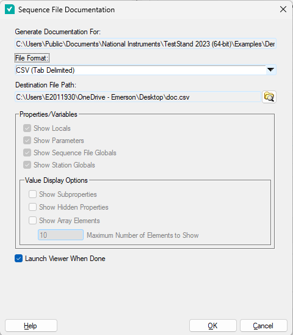
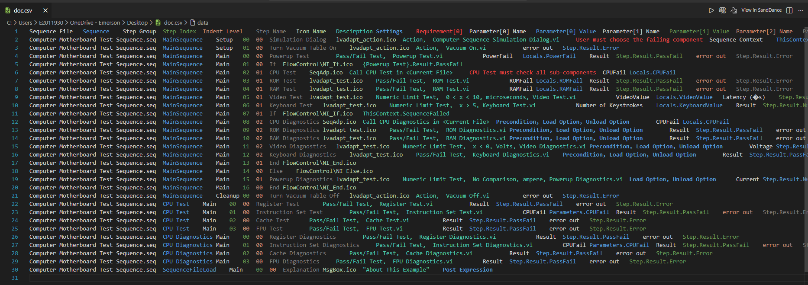

# **CSV Sequence File Documentation Tool – Proof of Concept**

This project demonstrates a **customized version of the Sequence File Documentation tool in TestStand**, implemented using **CVI** and integrated into the TestStand Tools menu. The customization focuses on generating documentation in **CSV format** and enhancing usability.

---

## **Overview**

The original TestStand Sequence File Documentation tool generates documentation in HTML or text formats. This Proof of Concept introduces:

- **CSV output support** for easier data manipulation.
- **UI and workflow improvements** in the CVI code.
- Integration with TestStand via **Tool Menu configuration**.

---

## **Project Structure**

```
csv-docgen-tool-teststand/
│
├── distribution/        # Deployment package (.pbs)
├── docs/                # Documentation files
│   └── README.md        # This file
├── resources/           # INI files for menus and strings
│   ├── CSV_DocGen_Menu.ini
│   └── CSV_DocGen_Strings.ini
├── src/                 # CVI source files and sequences
│   ├── doc.c, doc.h, doc.fp
│   ├── docclgs.h, docclgs.uir
│   ├── docgen.seq, docgen_csv.seq, docgen_html.seq, docgen_txt.seq
│   ├── DocSupport.prj, DocSupport.cws
│   └── cvibuild.DocSupport/
└── x64/                 # Compiled DLL (DocSupport.dll)
```

---

## **Build Instructions for CSV Sequence File Documentation Tool**

### Prerequisites
- NI LabWindows/CVI
- NI TestStand
- Windows x64 environment

### Steps
1. Clone the repository:
   ```bash
   git clone https://github.com/your-repo.git
   ```
2. Navigate to `src/` and open `DocSupport.cws` in CVI.
3. Build the project:
   - Select **Release x64** configuration.
   - Build → Generate DLL.
4. Verify output:
   - `DocSupport.dll` should appear in `x64/`.
5. Follow [Installation Steps](docs/README.md#installation-steps) to deploy.


## **Installation Steps**

1. Copy the following files/folders to their respective **TestStand Public** destinations:

| File/Folder              | Description                        | Destination                                                   |
|--------------------------|------------------------------------|--------------------------------------------------------------|
| `CSV_DocGen_Menu.ini`    | Tool Menu info file               | `<TestStandPublic>\Setup\ToolMenusToInstall`                |
| `CSV_DocGen`             | Folder with the tool files        | `<TestStandPublic>\Components\Tools`                        |
| `CSV_DocGen_Strings.ini` | Resource Strings for the tool     | `<TestStandPublic>\Components\Language\English`             |

2. **Restart TestStand** to load the new tool.

> [!NOTE]
> `CSV_DocGen_Menu.ini` will be deleted from `<TestStandPublic>\Setup\ToolMenusToInstall` once TestStand launches and processes it.

---

## **Uninstallation Steps**

1. Add a copy of `CSV_DocGen_Menu.ini` to `<TestStandPublic>\Setup\ToolMenusToUninstall`.
2. Delete the following files/folders:
  - `<TestStandPublic>\Components\Tools\CSV_DocGen`
  - `<TestStandPublic>\Components\Language\English\CSV_DocGen_Strings.ini`

3. **Restart TestStand** to load the new tool.

> [!NOTE]
> `CSV_DocGen_Menu.ini` will be deleted from `<TestStandPublic>\Setup\ToolMenusToUninstall` once TestStand launches and processes it.  

---


## **Usage**

First, make sure you have your target sequence file opena and selected as the active one.

After installation, the tool will appear under **Tools → Sequence File Documentation (CSV)...** in TestStand.  

[!Added Menu Item](img/added_menu_item.png)

In the dialog that shows up, make sure **CSV (Tab Delimited)** is selected and click OK.



---

## **Distribution**

If your interested in building this solution as a package, I created a few Package Builder Solution files for you to use as a reference in the (distribution)[/distribution] directory.

>[!NOTE] Before using NI Package Builder to build the packages, make sure you use the TestStand Version Selector to activate the target version of TestStand. NI Package Builder uses some pre-defined TestStand directories that change according to the currently activated version of TestStand.

 - **CSV_DOCGEN_TOOL_TS2023_Q4_X64.pbs** - Builds a package compatible with TestStand 2023 Q4 (64-bit)
 - **CSV_DOCGEN_TOOL_TS2025_Q3_X64.pbs** - Builds a package compatible with TestStand 2025 Q3 (64-bit)

## **Main CVI Code Modifications**

All changes are marked with `//NEW` in the source file. Below is a summary of the modifications and the new function added:

---

### **1. Added Support for CSV File Format**
```c
#define DOC_FILE_FMT_CSV      2
#define DOC_FILE_FMT_CSV_STR  "csv"
```

---

### **2. UI Dropdown Update**
```c
//NEW: Added CSV Entry to the Dropdown selector
tsErrChkMsgPopup(TS_GetResourceString(engine, "CSV_SEQ_FILE_DOC", "CSV_DOC_DLG_FMT", NULL, 512, string));
errChk(InsertListItem(dialogData->panel, DOC_CONFIG_FILE_FMT, -1, string, DOC_FILE_FMT_CSV));
```

---

### **3. Default Selection Logic**
```c
//NEW: If the value of the property is not "txt", set the dropdown to CSV instead of HTML
if(MBStrICmp(DOC_FILE_FMT_TEXT_STR, fileFmtStr) == 0)
    SetCtrlVal(dialogData->panel, DOC_CONFIG_FILE_FMT, DOC_FILE_FMT_TEXT);
else {
    SetCtrlVal(dialogData->panel, DOC_CONFIG_FILE_FMT, DOC_FILE_FMT_CSV);
    DocDialog_SetUnsupportedCtrlsEnableState(dialogData->panel, 1);
}
```

---

### **4. Property Update for File Format**
```c
//NEW: Added CSV as an Option for populating the "File Format" field
switch(fileFmt) {
    case DOC_FILE_FMT_TEXT:
        TS_PropertySetValString(docOptions, &errorInfo, DOC_OPT_FILE_FMT_PROP, 0, DOC_FILE_FMT_TEXT_STR);
        break;
    case DOC_FILE_FMT_HTML:
        TS_PropertySetValString(docOptions, &errorInfo, DOC_OPT_FILE_FMT_PROP, 0, DOC_FILE_FMT_HTML_STR);
        break;
    default:
        TS_PropertySetValString(docOptions, &errorInfo, DOC_OPT_FILE_FMT_PROP, 0, DOC_FILE_FMT_CSV_STR);
        break;
}
```

---

### **5. File Extension Handling**
```c
//NEW: Added csv extension to the output filename
switch(fileFmt) {
    case DOC_FILE_FMT_HTML:
        strcpy(fileExt, "html");
        DocDialog_SetUnsupportedCtrlsEnableState(panel, 0);
        break;
    case DOC_FILE_FMT_TEXT:
        strcpy(fileExt, "txt");
        DocDialog_SetUnsupportedCtrlsEnableState(panel, 0);
        break;
    default:
        strcpy(fileExt, "csv");
        DocDialog_SetUnsupportedCtrlsEnableState(panel, 1);
        break;
}
```

---

### **6. New Function Added**
```c
//CUSTOMIZATION: Functions added as part of the customization process
static int DocDialog_SetUnsupportedCtrlsEnableState(int panel, int enableState) {
    int error = 0;
    int disableCtrlList[] = {
        DOC_CONFIG_SHOW_PARAMS, DOC_CONFIG_SHOW_LOCALS,
        DOC_CONFIG_SHOW_FILEGLOBALS, DOC_CONFIG_SHOW_GLOBALS,
        DOC_CONFIG_SHOW_SUBPROPS, DOC_CONFIG_SHOW_HIDDEN,
        DOC_CONFIG_SHOW_ELEMS, DOC_CONFIG_MAX_ELEMS
    };
    for(int x = 0; x < sizeof(disableCtrlList); x++)
        errChk(SetCtrlAttribute(panel, disableCtrlList[x], ATTR_DIMMED, enableState));
Error:
    return error;
}
```

---

## **New Sequence File: `docgen_csv.seq`**

This sequence file implements the logic for generating **CSV documentation**. It follows a structured approach:

### **Sequence Structure**
- **Setup Group**
  - `Set Sequence File Ref`: Initializes the reference to the target sequence file.
- **Main Group**
  - `Parse Sequence`: Calls a subsequence to extract step and property data.
  - `Build Doc String`: Converts extracted data into a tab-delimited string.
  - `Save Doc To File`: Writes the final CSV string to the destination file.
- **Cleanup Group**
  - `Release Sequence File`: Releases the sequence file reference.

### **Supporting Sequences**
- **Extract Step Info**: Loops through steps and collects properties.
- **Extract Sequence Parameters**: Gathers subsequence parameters.
- **Extract LabVIEW Module Parameters**: Handles LabVIEW module-specific data.
- **Build Doc String**: Concatenates headers and body into a CSV-compatible format.

**Key Points:**
- The design ensures modularity: parsing, building, and saving are separate steps.
- Tab-delimited strings are used internally, then converted to CSV.
- Handles nested sequences and module parameters for completeness.

## **Sample Output**

Here is what the exported documentation looks like for the Computer Motherboard Sequence Example.

### **Visual Studio Code**



### **Excel**


---

## **Known Issues**
1. **We call it CSV, but it is a tab-delimited file**  
    - We decided to call it CSV to differentiate it from the current Text option, but the file contains a tab-delimited string file.
    - We didn't use commas because there are some property values being strings separated by a comma, and that generates a conflict when converting it to a table in Excel.
2. **Unsupported Options for CSV**  
   - Some property display options (e.g., Show Locals, Show Globals) are disabled for CSV because they are not yet implemented.
3. **Encoding Limitations**  
   - CSV output does not currently handle Unicode characters beyond UTF-8 properly.
4. **Viewer Launch Behavior**  
   - Launching the external viewer after generation may fail if the default application for `.csv` files is not set.
   - If Excel is your default application for CSV files, it will open the file, but not process the content correctly. You have to import the data in the file going to Data > From CSV/Text...
5. **Performance on Large Files**  
   Parsing very large sequence files can cause noticeable delays due to single-threaded execution.
6. **Unsuported Adapters Parameters**  
   This version only supports LabVIEW and Sequence adapters. Parameters from other adapters, such as .NET, Python, and C/C++ DLLs won't show up.

---

## **Future Enhancements**
- **Full Support for All Display Options**  
  Implement CSV-compatible handling for Locals, Globals, and complex property structures.
- **Advanced Filtering and Sorting**  
  Allow users to select which properties or steps to include in the CSV output.
- **Improved Encoding Support**  
  Add robust handling for multi-language and special characters beyond UTF-8.
- **Parallel Processing for Large Files**  
  Optimize parsing and generation for large sequence files using multi-threading.
- **Customizable Output Format**  
  Enable user-defined delimiters, column ordering, and optional headers.
- **Integration with Reporting Framework**  
  Provide direct export to Excel
- **Enhanced Error Handling**  
  Add detailed logs and user-friendly messages for missing or invalid sequence files.

---